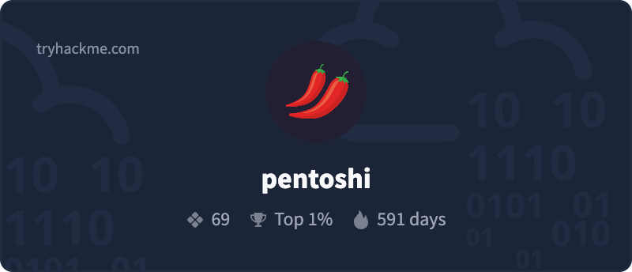

<!-- Header -->

  

  

  
  
  
  
  

---

### 👋 About me

I sit at the intersection of **security** and **software engineering**: I hunt threats, test web applications for vulnerabilities, and build secure, production-ready full-stack applications.

- 🛠️ Building **[clai](https://github.com/pentoshi007/clai)**, an open-source AI coding & pentesting agent for the terminal
- 🛡️ Blue + red team: SOC pipelines on Microsoft Sentinel, KQL detections mapped to MITRE ATT&CK, web app pentesting
- 🌐 Full-stack: TypeScript, React / Next.js, Node.js, microservices, MongoDB, PostgreSQL
- 🎓 B.Tech (ECE) & M.Sc (Economics) — Jawaharlal Nehru University, New Delhi
- 💼 Open to **Security Engineer / SOC Analyst / Full-Stack** roles

---

### 🚀 Featured projects

<table>
<tr>
<td width="50%" valign="top">

#### [clai](https://github.com/pentoshi007/clai) &nbsp;·&nbsp; [site](https://clai.aniketpandey.website)
Free AI coding & pentesting agent for your terminal. 35+ model providers (free keyless, ChatGPT, Copilot, Kiro, any API key, local Ollama), reviewable diffs, scope-aware recon workflows and a safety classifier for commands.

</td>
<td width="50%" valign="top">

#### [easySCP](https://github.com/pentoshi007/easySCP)
Send, receive and copy files over SSH by **picking** them, not typing paths. Server-to-server copy, resumable transfers and a two-pane browser — one small binary for macOS, Linux and Windows.

</td>
</tr>
<tr>
<td width="50%" valign="top">

#### [HTTP-Smuggler](https://github.com/pentoshi007/http-smuggler)
Async HTTP request smuggling detection & exploitation tool covering HTTP/1.1, HTTP/2, h2c and WebSocket variants. 100+ payloads, safety modes, built-in callback listeners and multi-format reports.

</td>
<td width="50%" valign="top">

#### [Vortex CTI](https://github.com/pentoshi007/vortex) &nbsp;·&nbsp; [live](https://vortex-cti.vercel.app)
Cyber Threat Intelligence dashboard for tracking and enriching IOCs. Auto-ingests URLhaus feeds, enriches via VirusTotal & AbuseIPDB, with RBAC (Admin / Analyst / Viewer) and CSV/JSON export.

</td>
</tr>
<tr>
<td width="50%" valign="top">

#### [Tomato](https://github.com/pentoshi007/Tomato) &nbsp;·&nbsp; [live](https://tomato.aniketpandey.website)
Food delivery platform: React SPA backed by six Express microservices, RabbitMQ events, Socket.IO realtime tracking, Google OAuth and Razorpay/Stripe payments. Dockerized end to end.

</td>
<td width="50%" valign="top">

#### [JobScope](https://github.com/pentoshi007/jobscope-web) &nbsp;·&nbsp; [live](https://jobscope-web.vercel.app)
AI job aggregator: upload a resume, get ranked matches from 8 job sources, track applications on a Kanban board and receive daily digest emails. Gemini-parsed resumes with PII redaction.

</td>
</tr>
</table>

<a href="https://github.com/pentoshi007?tab=repositories">More on my repositories →</a>

---

### 🧰 Tech stack

  <b>Languages</b>  
  

  <b>Web & Backend</b>  
  

  <b>Cloud & DevOps</b>  
  

  <b>Security</b>  
  
  
  
  
  
  
  

---

### 🛡️ Security credentials

  

  
  
  
  
  

---

### ✍️ Latest writing

- [Building a real SOC lab with Microsoft Sentinel from scratch](https://blogs.aniketpandey.website/building-a-real-soc-lab-with-microsoft-sentinel-from-scratch)
- [clai: a free AI CLI for your terminal and pentesting work](https://blogs.aniketpandey.website/clai-a-free-ai-cli-for-your-terminal-and-pentesting-work)
- [Tracking an insider threat — TryHackMe "Have a Break" writeup](https://blogs.aniketpandey.website/tracking-an-insider-threat-tryhackme-have-a-break-writeup)

---

### 📈 Activity

  

  <picture>
    <source media="(prefers-color-scheme: dark)" srcset="https://raw.githubusercontent.com/pentoshi007/pentoshi007/output/github-contribution-grid-snake-dark.svg" />
    <source media="(prefers-color-scheme: light)" srcset="https://raw.githubusercontent.com/pentoshi007/pentoshi007/output/github-contribution-grid-snake.svg" />
    
  </picture>

<!-- Footer -->

  

